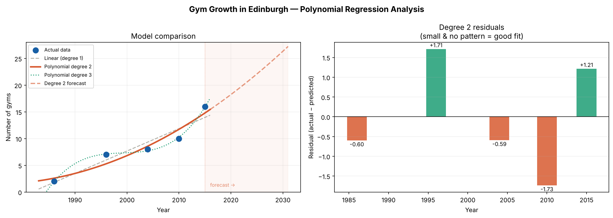

# Edinburgh Gym Growth

Small data science project looking at how the number of gyms in Edinburgh has grown since the 80s. I used the number of gyms in 1986, 1996, 2004, 2010 and 2015 (read off a chart), fitted linear and polynomial regression models to them with numpy, compared them using R² and RMSE, then used the degree 2 model to forecast how many gyms there might be up to 2030. The degree 2 curve fit best without overfitting (R² of 0.92 vs 0.90 for linear) and predicts around 26 gyms by 2030, but with only 5 data points the forecast is more of a rough trend than anything exact. Everything is in `gym_regression.ipynb`, to run it you just need numpy, pandas, matplotlib and Jupyter.

